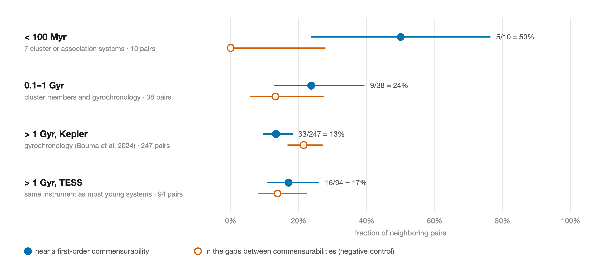

# Youth and near-resonant planet pairs: a causal re-analysis

Code and data for the Research Note *"Youth Raises the Incidence of Near-resonant Planet Pairs: A Causal Re-analysis"* (in preparation for RNAAS).

**Question.** Are planet pairs in young systems more often near a first-order mean-motion commensurability *because* the systems are young, once confounders are adjusted for and a negative control is applied?

**Main result.** Pairs in the seven transiting multi-planet systems younger than 100 Myr are near-resonant in 5 of 10 cases (50%), against 33 of 247 (13%) in mature Kepler systems dated by gyrochronology. Adjusting for stellar effective temperature, metallicity and inner period, the effect is +33.9 percentage points (95% CI +5.0 to +58.6; permutation p = 0.0014). Without planets found through transit timing variations, the recount of Hansen et al. (2025) gives 3 of 9; with the 2026 period of V1298 Tau e and HIP 67522 b/c it gives 5 of 10 (p = 0.016).



## Requirements

Python 3.8 or later. **Standard library only**: no numpy, scipy or pandas.

## How to reproduce

```bash
python3 -I fetch_data.py
```

```bash
python3 -I causal_v3_young.py
```

```bash
python3 -I hansen_recount.py
```

```bash
python3 -I make_figure1.py
```

The first command downloads the gyrochronology table of Bouma et al. (2024) from its arXiv source; it is not redistributed here. The NASA Exoplanet Archive tables in `data/` are the snapshot of 2026-11-26. `python3 -I fetch_data.py --refresh-nasa` replaces them with the current archive, and the numbers may then change.

Earlier stages of the analysis, also reported in the note:

```bash
python3 -I causal_v2_gyro.py data/kepler_koi_cumulative.csv data/bouma2024_koi_ages.csv
```

```bash
python3 -I causal_v1_catalog.py data/pscomppars_multi.csv
```

## Files

| File | What it does |
|---|---|
| `causal_v3_young.py` | Main analysis: the seven systems younger than 100 Myr against mature Kepler (gyrochronology) and mature TESS systems; g-computation, system bootstrap, system-level permutation test, negative control, sensitivity analyses |
| `hansen_recount.py` | Reproduces the TTV-free recount of Hansen et al. (2025) and adds the later data one step at a time |
| `causal_v2_gyro.py` | Kepler pairs with gyrochronological ages (0.1–1 Gyr against older than 1 Gyr) |
| `causal_v1_catalog.py` | First pass with heterogeneous archive ages; also holds the shared helpers (logistic regression, windows, negative-control windows) |
| `make_figure1.py` | Draws Figure 1 as SVG |
| `fetch_data.py` | Downloads the inputs |
| `data/` | NASA Exoplanet Archive snapshot (`pscomppars` and `cumulative` tables) |
| `results/` | Console summaries (`summary_*.txt`), pair-level tables (`pairs_*.csv`) and Figure 1 |

Each `pairs_*.csv` has one row per neighboring planet pair: the treatment (`joven` or `grupo`), the outcome (`resonante`), the adjustment variables (`teff`, `metalicidad`, `log_p_interno`), the negative control (`placebo_limpio`) and the system identifier for clustering.

Code comments, variable names and console output are in Spanish.

## Definitions

- **Near-resonant:** period ratio within −0.5% to +2.5% of 2:1, 3:2, 4:3, 5:4 or 6:5. The window of Dai et al. (2024), −1.5% to +3%, is a sensitivity analysis.
- **Negative control:** five windows of the same 3% width in the gaps between first- and second-order commensurabilities (1.553–1.600, 1.701–1.752, 1.761–1.815, 1.824–1.879, 1.889–1.946). An earlier version shifted each commensurability by a fixed percentage, which landed on other commensurabilities (4:3 × 1.12 ≈ 3:2); that version was replaced.
- **Adjustment set:** stellar effective temperature, metallicity and log inner period. Planet radius and multiplicity are not adjusted for, because they change with age.

## Data sources

- NASA Exoplanet Archive (Akeson et al. 2013, PASP 125, 989), tables `pscomppars` and `cumulative`, queried on 2026-11-26. This research has made use of the NASA Exoplanet Archive, which is operated by the California Institute of Technology, under contract with the National Aeronautics and Space Administration under the Exoplanet Exploration Program.
- Bouma, L. G., et al. 2024, *Ages of Stars and Planets in the Kepler Field Younger Than Four Billion Years*, [arXiv:2410.06246](https://arxiv.org/abs/2410.06246).

## Related work

- Dai, F., et al. 2024, AJ, 168, 239
- Hansen, B. M. S., Yu, T.-Y., Nagarajan, N., & Hasegawa, Y. 2025, [arXiv:2510.01332](https://arxiv.org/abs/2510.01332)
- Choksi, N., Lithwick, Y., Chiang, E., & Li, R. 2026, [arXiv:2604.05035](https://arxiv.org/abs/2604.05035)
- Livingston, J. H., et al. 2026, Nature, 649, 310

## License and authorship

Code under the MIT License (see `LICENSE`). The data belong to their original sources. The code was written with the assistance of an AI model (Claude, Anthropic); the author checked the results.
